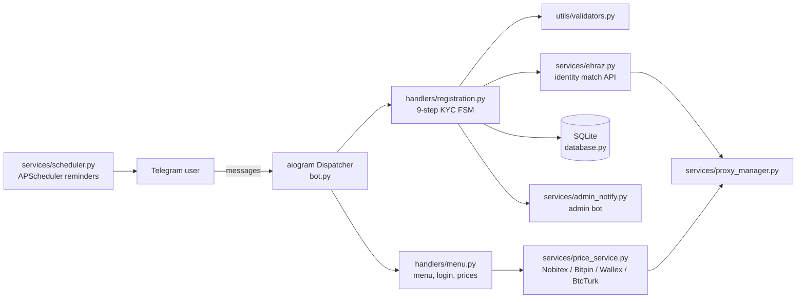

# telbot: Telegram registration & KYC bot (aiogram 3)

[](https://github.com/jjebraham/telbot/actions/workflows/python-check.yml)

An async Telegram bot that registers users for a currency-exchange service. It takes them through a 9-step KYC form in Persian, checks the identity data against an external verification API, and sends each completed application to an admin bot for review. It also quotes live USDT/IRR and USDT/TRY exchange rates.

This repository is an earlier, self-contained version of the bot behind the Kiani Exchange service. The production code is private and has moved on since then. This version can run locally with no real credentials.

## What it does

- **Guided registration:** an FSM-driven form (first name → last name → phone (shared contact) → national ID → Jalali date of birth → bank card → terms → ID card front/back photos). A live progress message shows each step, and fields can be edited before you submit.
- **Input validation:** Iranian national-ID checksum, Luhn check for card numbers, Persian-only names, and Persian/Arabic digit normalisation. It also accepts Jalali dates in many formats (`utils/validators.py`).
- **Identity matching:** card number + national ID + date of birth are checked against the [Ehraz](https://ehraz.io) API, with a daily attempt limit per user (`services/ehraz.py`).
- **Admin review:** each finished application is posted to admins by a second bot (`services/admin_notify.py`).
- **Live prices:** USDT/IRR from Nobitex → Bitpin → Wallex in fallback order, and USDT/TRY from BtcTurk, with caching and optional proxy rotation (`services/price_service.py`).
- **Engagement:** APScheduler sends follow-up reminders to users who stop mid-registration, and an idle guard returns inactive users to the main menu after 5 minutes.
- **Telegram Mini App** launcher button in the chat menu.

## Architecture



## Run it locally

```bash
python -m venv .venv && source .venv/bin/activate
pip install -r requirements-dev.txt
cp .env.example .env
```

Create two bots with [@BotFather](https://t.me/BotFather), put their tokens in `MAIN_BOT_TOKEN` and `ADMIN_BOT_TOKEN`, and set `ADMIN_CHAT_ID` to your own chat ID. `EHRAZ_MOCK=true` (already set in `.env.example`) simulates identity matching, so the whole registration flow works without an Ehraz account.

```bash
python bot.py
```

The SQLite database is created automatically on first run.

## Tests

```bash
python -m pytest -q
```

The tests cover the validators, the price-API parsers, the database layer (on a temporary SQLite file), proxy-credential masking and the identity-matching mock. CI runs them on every push and pull request, and also checks that the bot module imports and the Mini App types build.

## External services

| Service | Used for | Needed locally? |
|---|---|---|
| Telegram Bot API | everything | yes (two free bot tokens) |
| Ehraz | card / national ID / DOB matching | no, use `EHRAZ_MOCK=true` |
| Nobitex, Bitpin, Wallex, BtcTurk public APIs | live prices | no key needed; Wallex key optional |

## Security notes

- All credentials come from environment variables, and `.env` is git-ignored.
- Proxy credentials are masked before they are logged (`utils/redact.py`).
- Database column names are allow-listed before they are put into SQL.
- ID card photos are stored only as Telegram `file_id`s, never downloaded.

## Project structure

```
bot.py                  entry point: bot, dispatcher, routers, scheduler, Mini App button
config.py               environment configuration
database.py             SQLite schema and helpers
keyboards.py, states.py reply keyboards and FSM states
handlers/               menu and registration routers
services/               Ehraz, prices, proxies, scheduler, idle guard, admin notifications
utils/                  validators, form rendering, log redaction
tests/                  pytest suite
```

## License

The source is published so that it can be reviewed as a portfolio sample. No open-source license is granted. Please contact me before reusing it.
